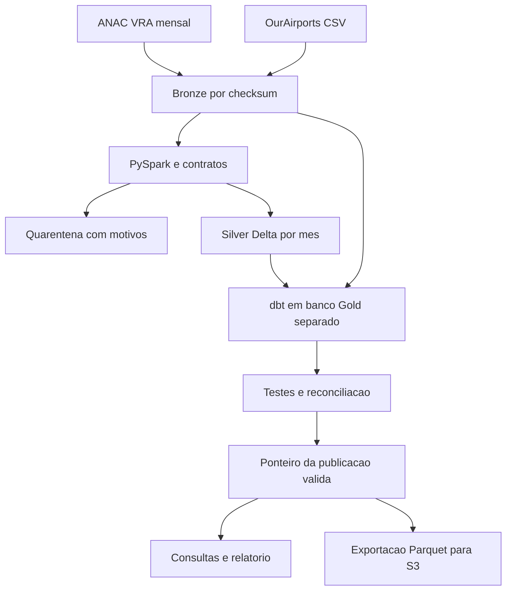

# FlightLedger

**Um arquivo histórico mudou. O lakehouse consegue absorver a revisão sem duplicar voos nem manter agregações antigas?**

Pipeline de engenharia de dados para auditar operações aéreas brasileiras. Usa arquivos mensais reais da ANAC, cruza os aeroportos com OurAirports e publica uma camada analítica depois das validações.

O primeiro trimestre de 2025 foi processado de ponta a ponta: **250.594 registros na origem, 250.568 publicados e 26 em quarentena**. A quarentena contém chaves de negócio repetidas com informações divergentes. Nenhum erro foi inserido nos arquivos reais.


## Stack

Python 3.12 · PySpark 3.5 · Delta Lake · dbt Core · DuckDB · Airflow · Docker · GitHub Actions · S3 opcional

PySpark normaliza e valida os arquivos. Delta Lake registra as versões da Silver e permite substituir somente os meses alterados. dbt constrói e testa os modelos analíticos no DuckDB. A escrita Delta usa **delta-rs**, evitando dependência de downloads de conectores Maven durante a execução local. Não há runtime Databricks neste projeto.

## O que está resolvido

- **Revisões de origem:** o SHA-256 identifica o conteúdo de cada arquivo. Uma republicação vira outro snapshot Bronze.
- **Carga incremental:** somente meses com conteúdo diferente são normalizados e substituídos na Silver. A unidade incremental é o arquivo mensal, não cada linha nem CDC de banco.
- **Exclusões:** substituir a partição remove registros que desapareceram do snapshot mensal. Um upsert isolado não resolveria isso.
- **Agregações antigas:** o modelo incremental dbt remove os meses afetados antes de recalcular. Isso também elimina trechos que sumiram completamente da origem.
- **Falhas:** um banco Gold separado recebe os modelos e testes. O ponteiro público muda apenas após sucesso; uma falha preserva a publicação anterior.
- **Reprocessamento:** `replay` reconstrói as camadas a partir dos arquivos Bronze, sem consultar a ANAC.
- **Concorrência:** um lock de processo impede duas cargas simultâneas no mesmo diretório.
- **Auditoria:** hashes, contagens, diferenças entre snapshots, versão Delta e artefatos dbt ficam disponíveis por execução.

## Execução rápida

Requisitos locais: **Python 3.12 e Java 17**. Reserve cerca de 2 GB livres para dependências e dados; a memória necessária varia com o ambiente. O processamento local usa dois workers Spark.

```bash
python -m venv .venv
```

```powershell
# Windows PowerShell
.venv\Scripts\Activate.ps1
```

```bash
# Linux ou macOS
source .venv/bin/activate
```

Na raiz do projeto:

```bash
python -m pip install -r requirements.lock
python -m pip install -e . --no-deps
flightledger sync --months 2025-01 2025-02 2025-03
flightledger report
flightledger audit
```

Abra `reports/report.html` no navegador. No GitHub, veja os [resultados da carga](reports/results.md), as [contagens e hashes](reports/validation.json) e os [testes executados](docs/validation.md).

Os arquivos de voos do trimestre somam cerca de 78 MB; o cadastro de aeroportos acrescenta cerca de 13 MB. Os dados brutos e os bancos não são versionados no Git. O download ocorre na primeira execução e pode demorar conforme a fonte e a conexão.

## Com Docker

Crie o diretório `data` antes de iniciar. Em Linux, alinhe o UID dos contêineres ao seu usuário para que pipeline e Airflow consigam compartilhar os arquivos:

```bash
mkdir -p data reports
printf 'AIRFLOW_UID=%s\n' "$(id -u)" > .env
```

No Windows, crie a pasta `data` ao lado do README; o UID padrão é 50000.

```bash
docker compose build pipeline
docker compose run --rm pipeline
docker compose run --rm pipeline report
docker compose run --rm pipeline audit
```

O Docker fornece Python e Java. Os diretórios `data/` e `reports/` permanecem no computador por bind mount. A execução com contêiner não foi testada neste ambiente; há um job manual de CI para construir as imagens. O caminho Python/Java foi executado com os dados reais.

## Arquitetura



| Camada | Grão e função |
|---|---|
| Bronze | Arquivo original mensal, identificado pelo SHA-256 |
| Quarentena | Registro rejeitado, motivo, mês e hash da origem |
| Silver | Etapa de voo, com partição `source_month` e histórico Delta |
| `dim_airport` | Código de aeroporto, com resolução determinística de repetidos |
| `fct_flight` | Etapa de voo e elegibilidade para medir pontualidade |
| `fct_daily_operations` | Dia, empresa, origem, destino e mês da fonte |
| `mart_route_reliability` | Mês, empresa e trecho, com denominadores e cobertura |

## Atualizações e backfill

```bash
# Conferir se a ANAC republicou os arquivos selecionados
flightledger sync --months 2025-01 2025-02 2025-03 --refresh

# Acrescentar outro mes
flightledger sync --months 2025-04

# Reprocessar os snapshots locais, sem download
flightledger replay

# Usar arquivos ja baixados, com os nomes originais
flightledger sync --months 2025-01 --input-dir data/downloads
```

Sem `--refresh`, o cache de download é reutilizado. Uma nova execução com o mesmo conteúdo retorna `NOOP`: não inicia o Spark nem cria outra publicação. Ao alterar contratos Python, execute `replay`; mudanças nos modelos dbt são detectadas pelo hash do projeto.

## Orquestração

```bash
docker compose --profile orchestration up --build airflow
```

Abra `http://localhost:8080`; as credenciais do ambiente de desenvolvimento aparecem nos logs do Airflow. A DAG `flightledger_revisions` confere as revisões toda segunda-feira, com retentativas, timeout e uma execução ativa por vez. O trimestre é um parâmetro editável no disparo manual. As tarefas executam a carga e verificam o checksum do banco publicado.

Airflow roda em modo `standalone` para desenvolvimento, com ambiente Python separado do pipeline. Isso evita misturar as dependências do orquestrador com Spark e dbt. A configuração não representa um deployment de produção.

## Qualidade e semântica

- O número do voo é texto: valores como `Z0406` existem na fonte e são preservados.
- Segundo a ANAC, os horários do VRA usam **Brasília**, inclusive nos trechos internacionais. A Silver os converte para UTC.
- Cancelamento não é atraso zero. A taxa de cancelamento usa todas as etapas publicadas; o OTP usa apenas voos realizados com horários comparáveis.
- **OTP15** significa diferença entre horário real e previsto menor ou igual a 15 minutos. Antecipações contam como pontuais neste indicador do projeto.
- Voos sem horário previsto permanecem na base e reduzem a cobertura do indicador.
- Chaves conflitantes não recebem um “último registro” arbitrário: todas as versões ambíguas vão para quarentena.
- O limite padrão de quarentena é 2% por arquivo. Ultrapassar o limite interrompe a publicação. Esse limite é uma política do projeto, não um padrão da ANAC.
- OurAirports é um cadastro atual. Seu enriquecimento não representa o estado histórico dos aeroportos em 2025. Falta de correspondência é medida, sem remover o voo.

## Testes

```bash
python -m unittest discover -s tests -v
```

Os testes cobrem cache e checksum, download incompleto, resposta HTML, idempotência, UTC, denominadores, substituição de partição, exclusão de agregações antigas, falha de qualidade, recuperação depois de falha na Gold, replay, concorrência e publicação do manifesto S3 somente após todos os uploads. Os testes usam fixtures pequenas; a validação com 250 mil registros está documentada separadamente.

## S3 opcional

```bash
flightledger export-s3 --bucket SEU_BUCKET --prefix flightledger
```

Usa a cadeia padrão de credenciais do boto3 e um bucket já existente. Não cria infraestrutura. Exporta quatro modelos Gold em Parquet e grava um manifesto com hashes ao final. Também aceita `--endpoint` para armazenamento compatível com S3. O cliente foi testado com simulação de falha; não houve implantação em AWS. A execução local não precisa de conta cloud.

## Documentação

- [Contrato e regras dos dados](docs/data_contract.md)
- [Decisões de arquitetura](docs/architecture.md)
- [Operação e recuperação de incidentes](docs/runbook.md)
- [Vagas consideradas na escolha da stack](docs/market_alignment.md)
- [Validação e limites](docs/validation.md)

O projeto demonstra operação de pipelines e consistência de dados em uma execução local. O volume usado não exige Spark por si só e não comprova escala distribuída. A escolha permite exercitar particionamento e transformações reproduzíveis antes de uma eventual migração para infraestrutura gerenciada.
