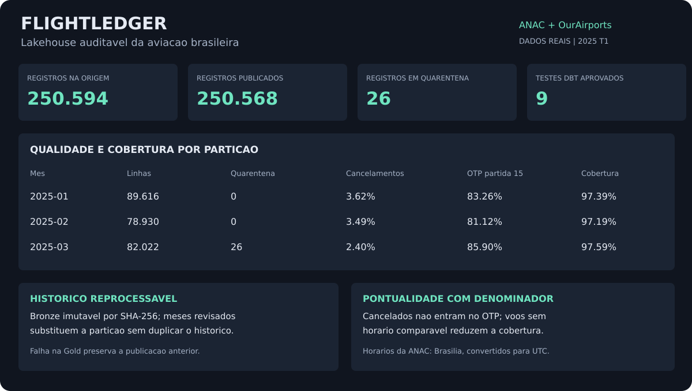

# Resultado da carga real

Fonte: ANAC VRA, janeiro a março de 2025; cadastro OurAirports obtido em outubro de 2026.

- Registros de voos na origem: **250,594**.
- Registros publicados: **250,568**.
- Registros em quarentena: **26**; março contém chaves de negócio conflitantes.
- Duplicatas idênticas removidas: **0**.
- Testes dbt aprovados na publicação: **9**.
- Códigos na dimensão de aeroportos: **86,218**; voos com origem sem correspondência: **78**.

| Mês | Etapas publicadas | Cancelamentos | OTP partida até 15 min | Cobertura de partida |
|---|---:|---:|---:|---:|
| 2025-01 | 89,616 | 3.615% | 83.264% | 97.392% |
| 2025-02 | 78,930 | 3.488% | 81.120% | 97.191% |
| 2025-03 | 82,022 | 2.404% | 85.896% | 97.595% |

OTP considera apenas voos realizados com ambos os horários comparáveis. Cancelamentos têm denominador próprio. Voos sem previsão permanecem na base; não recebem atraso zero. Não é um ranking de companhias nem uma medida regulatória oficial. Os valores mudam caso a fonte seja revisada.

Os hashes e contagens estão em `validation.json`. As transformações usam arquivos oficiais sem inserir erros na carga real. Os cenários de falha, revisão e recuperação são exercitados separadamente nos testes.
